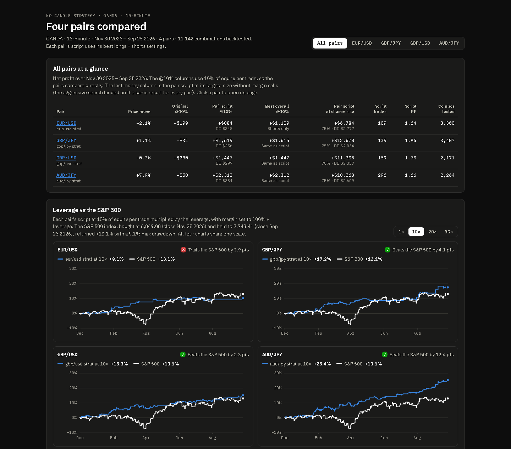

<div align="center">

# NO Candle Strategy

**A rule-based price-action strategy in Pine Script, tuned over 11,142 backtests on four currency pairs.**

[**Open the results dashboard**](https://anish-achar.github.io/no-candle-strategy/dashboard/) · [Project write-up](https://anishachar.com/#projects/trading) · [Pine script](strategy/no_candle_strategy.pine)


<a href="https://anish-achar.github.io/no-candle-strategy/dashboard/"></a>

</div>

---

I wrote the strategy on TradingView, then tuned it on four FX pairs (15-minute charts, 30 Nov 2025 to 25 Sep 2026, $100K test account). **The original settings lost money on every pair. The tuned versions are profitable on all four**, trading both long and short.

| Backtests | Pairs profitable | Profit factor | Max drawdown |
|:---:|:---:|:---:|:---:|
| **11,142** | **4 / 4** (up from 0 / 4) | **1.64–1.96** | **1.9–2.6%** at 75% of equity per trade |

## The rules

| # | Part | What it does |
|---|---|---|
| 1 | **Trend filter** | Decides which way setups can trade: internal market structure (breaks of structure from swing pivots), an EMA, both together, or either one |
| 2 | **The NO candle** | The core signal: a candle that opens right at its high or its low, with no wick on the open side. *Wick tolerance* sets how exact that has to be |
| 3 | **Setup window** | Each NO candle places a limit order at its open, live for a set number of candles, with a cap on how many can be pending at once |
| 4 | **Stop loss** | Either a multiple of the NO candle's range, or the last swing point (with an optional tick buffer, beyond the wick or not) |
| 5 | **Target & direction** | A fixed reward:risk multiple of the stop distance; longs, shorts or both |

The full, commented rules are at the top of [`strategy/no_candle_strategy.pine`](strategy/no_candle_strategy.pine).

## How it was tuned

```
Baseline ──► One-at-a-time sweep ──► Coordinate descent ──► Full grid + polish ──► Guardrails
(lost on      (which settings         (12 restarts to        (wick × stop × R:R      (≥ 100 trades,
 all 4 pairs)  actually matter)        avoid local optima)    around the winners)     drawdown ≤ original)
```

**Ranges tested:** trend mode (all 4) · pivot 1–5 · EMA 50–300 · validity 3–20 · pending 1–5 · wick tolerance 0–10 ticks · swing-stop buffer 0–20 ticks · NO-range stop 0.5–6× · reward:risk 0.5–3 · direction · position size 5–100% · leverage 10×, 20×, 50×.

## Results by pair

At 10% of equity per trade, so the pairs compare directly:

| Pair | Original settings | Tuned script | Trades | Profit factor | Max drawdown |
|---|---:|---:|---:|---:|---:|
| EUR/USD | −$199 | **+$884** | 109 | 1.64 | $348 |
| GBP/JPY | −$31 | **+$1,615** | 135 | 1.96 | $256 |
| GBP/USD | −$280 | **+$1,447** | 159 | 1.70 | $297 |
| AUD/JPY | −$58 | **+$2,312** | 296 | 1.66 | $334 |

The [interactive dashboard](https://anish-achar.github.io/no-candle-strategy/dashboard/) goes deeper: equity curves, every combination tested, how sensitive each winner is to each setting, position sizing, and leverage against the S&P 500.

## Repository layout

```
no-candle-strategy/
├── strategy/
│   └── no_candle_strategy.pine   # the TradingView strategy (Pine Script v6)
├── dashboard/                    # interactive results dashboard (open index.html)
│   ├── index.html
│   ├── overview.js
│   └── data-*.js                 # per-pair results and the leverage study
├── data/
│   └── backtests.json            # raw results from the settings search
├── results/
│   └── optimisation-log.md       # the full log: method, winners, sensitivity, caveats
└── CLAUDE.md                     # the AI-assisted TradingView workflow used while building it
```

## Try it

- **Strategy:** paste `strategy/no_candle_strategy.pine` into TradingView's Pine Editor, add it to a 15-minute chart and open the Strategy Tester.
- **Dashboard:** open it [online](https://anish-achar.github.io/no-candle-strategy/dashboard/), or clone the repo and open `dashboard/index.html`.

## Read these numbers with care

- These are **simulated backtests, not live trading**, and nothing here is financial advice.
- All results are **in-sample**: the settings were tuned and measured on the same data.
- No commission or spread was modelled (2 ticks of slippage only), so live results would be lower.
- EUR/USD fell about 2.1% over the test period, and its best overall result (shorts only) depends on shorting that move.

---

<sub>Built by <a href="https://anishachar.com">Anish Achar</a>. Part of my <a href="https://github.com/Anish-Achar">portfolio</a>.</sub>
